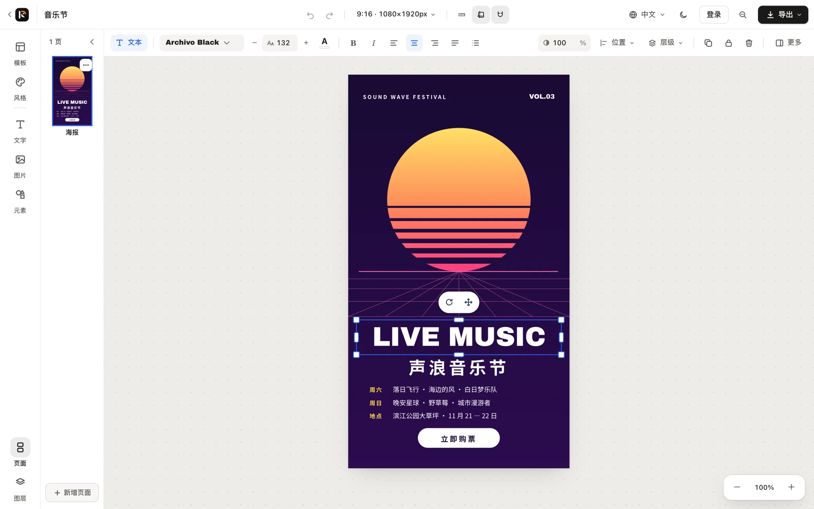
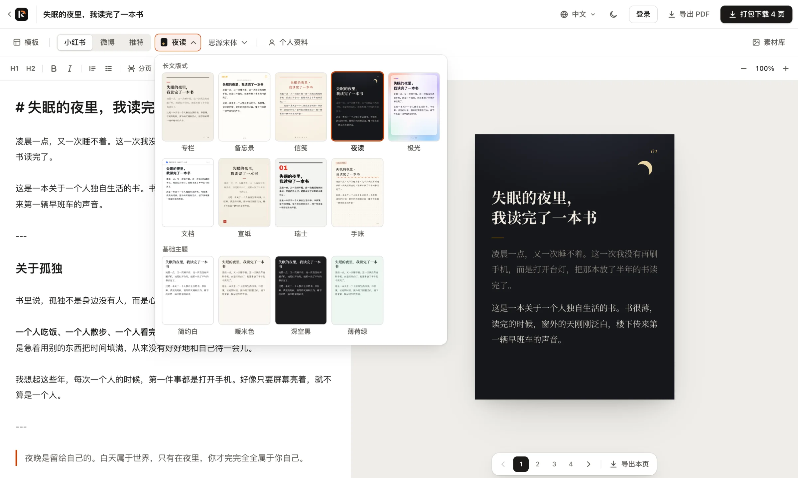
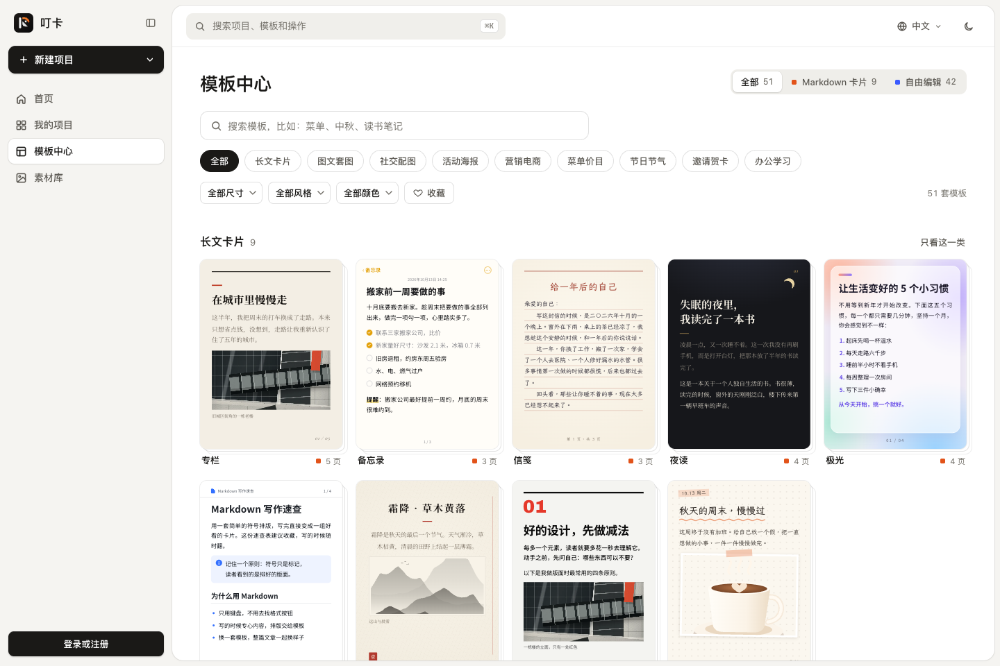
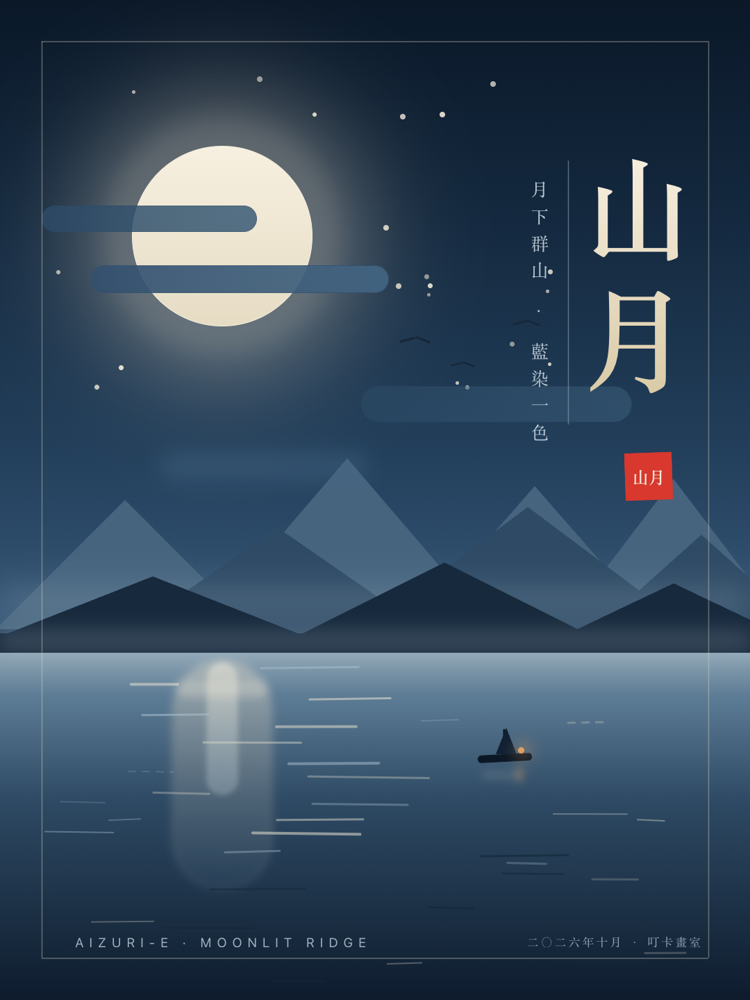
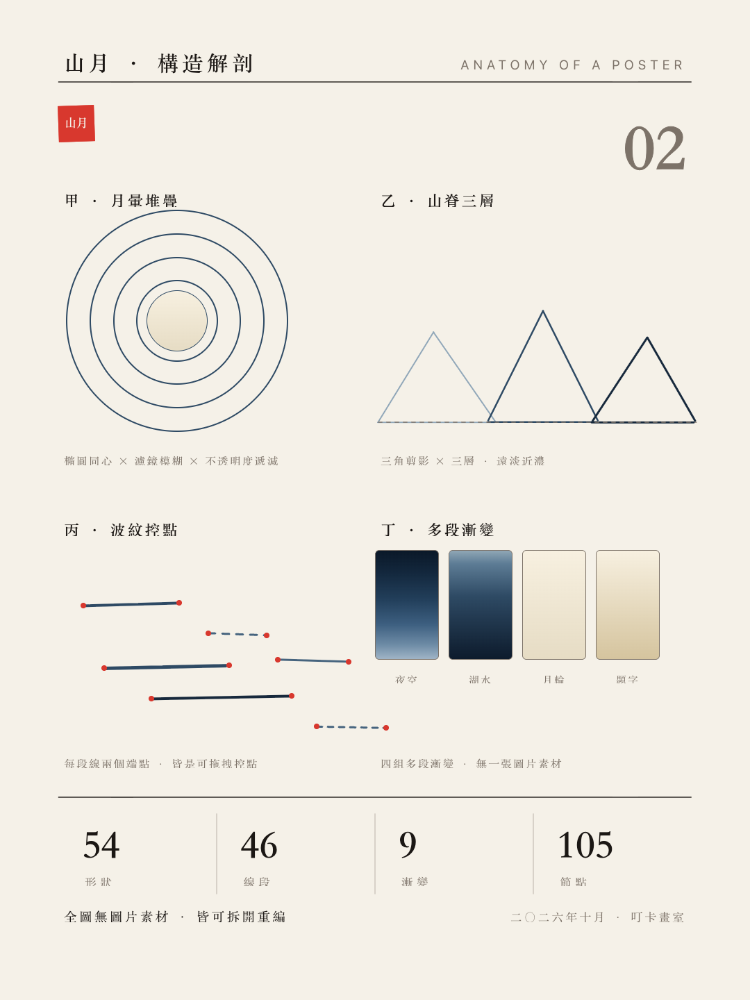

<div align="center">
  <h1> 叮卡 DingCard</h1>
  <p><strong>长文自动排成卡片，海报随手自由排版。</strong></p>
  <p>浏览器里的开源图文卡片编辑器。AI 客户端通过 MCP 使用同一套文档模型、校验和导出，生成的作品可以直接在编辑器里接着改。</p>
  <p>
    <a href="https://dingcard.pages.dev"><strong>产品介绍</strong></a> ·
    <a href="https://dingcard.vercel.app"><strong>在线使用</strong></a> ·
    <a href="docs/mcp.md">MCP 文档</a> ·
    <a href="docs/deployment.md">部署指南</a> ·
    <a href="CHANGELOG.md">更新日志</a>
  </p>
  <p>
    <a href="CHANGELOG.md"></a>
    <a href="https://github.com/lottshin/DingCard/actions/workflows/ci.yml"></a>
    <a href="https://dingcard.vercel.app"></a>
    <a href="https://github.com/lottshin/DingCard/pkgs/container/dingcard"></a>
    <a href="LICENSE"></a>
  </p>
</div>



<p align="center"><strong>84</strong> 套模板 · <strong>22</strong> 个 MCP 工具 · <strong>8</strong> 种预设尺寸 · <strong>MIT</strong> 开源</p>

## 自由画布

**选中任意元素，就地修改。** 文字、图片、形状、线段、图标、图表、表格、时间线和二维码放在同一块画布上；多页作品的每一页可以设不同尺寸。

- **文字**：选中一段单独加粗、标色、高亮或加下划线；16 种花字一键套用（霓虹、描边、立体、标签底色……）；自己的字体文件（TTF / OTF / WOFF / WOFF2）可以导入，画布和导出都按它画。
- **图片**：独立图片进入裁剪后，可以在原画框里移动图片、拖动八个黑柄，或按比例调整画框；还能加圆角、相框和滤镜。部署服务端后，图片抽屉里的在线图库可以直接搜可商用的图片。
- **素材**：97 个可搜索的线性图标，48 个手绘线条、贴纸和标签；图表有柱状、环形、折线和雷达，数据可以从表格里整列粘贴。
- **风格**：一键给整套卡片换配色或字体组合；改一个颜色或字体时点「全部替换」，整套里同样的颜色和字体一起换掉。
- **图层**：改名、排序、编组、隐藏、锁定。
- **导出与分享**：PNG、JPG、PDF，可以只导当前页，也可以打包成 ZIP、合成一个 PDF、拼成一张长图，或切成朋友圈九宫格。部署服务端后还能生成分享链接，手机扫码就能看，长按存图。

## Markdown 长文

**一篇长文，按卡片尺寸自动分页。** 把 Markdown 粘到左边，右边按小红书、微博或推特的尺寸实时分页；`---` 手动分页，标题不会单独落在页底。图片粘贴后可以在预览里直接调宽度。

九套长文版式：专栏、备忘录、信笺、夜读、极光、文档、宣纸、瑞士、手账。每套有自己的页眉、页码、标题层级、引文、列表、待办、代码和表格样式，正文一个字不动就能换。



## 模板

**84 套模板，都在仓库里维护。**

- **Markdown 长文版式** 9 套。
- **三页套图** 自由画布有八套：编辑部、清单、信号、夜航、粗野、蓝图，和 16:9 的演示套图聚光、答辩。封面、内页、结尾各一页；用 MCP 生成整套卡片时，会按每页的内容换成观点页、清单页、数据页或收尾页。
- **单页模板** 67 张，覆盖 8 种尺寸：小红书 3:4、竖版海报 9:16、方图 1:1、横版 16:9、公众号首图 2.35:1、A4 竖版和横版、朋友圈九宫格。从封面、海报、菜单价目、证书、简历和通知，到节日节气和邀请贺卡。

模板中心按名称、标签、用途和风格搜索，再按尺寸、风格、颜色和收藏筛选；每套模板按自己的比例排开，点开先看每一页和相似模板。在编辑器里，模板也能一页一页加进正在做的作品。做了一套好看的版式，可以按[贡献模板](docs/templates.md)提交 Pull Request，合并后所有人都能用。



## MCP 自动化

**AI 客户端，直接出整套卡片。** stdio MCP 服务器 `dingcard-mcp` 发布在 npm 上，提供 22 个工具。文档校验、编辑和渲染跟编辑器共用同一套代码；工具之间传 `documentId`，图片可以直接写本机路径。在 MCP 客户端的配置里加上：

```json
{
  "mcpServers": {
    "dingcard": { "command": "npx", "args": ["-y", "dingcard-mcp"] }
  }
}
```

需要 Node.js 22 以上和本机安装的 Google Chrome（渲染和检查用）。

| 工具 | 做什么 |
|---|---|
| `list_templates` | 列出模板的尺寸、用途、风格，以及能放多少内容 |
| `create_document_from_content` | 按内容生成整套卡片，模板的示例文字全部换掉 |
| `check_document` | 按导出的样子检查文字被裁、叠住、对比度低、残留示例文字和大片留白，放不下的字自动缩小 |
| `render_document` | 无头渲染成逐页 PNG、JPG，一个 PDF、一张长图或九宫格切图 |
| `open_in_editor` | 在叮卡编辑器里打开，由人接着改 |

另外还有按大纲生成整套卡片、生成单张海报、把 HTML 转成可编辑的设计、加入模板页、放装饰素材、搜索和导入在线图库的图片、生成分享链接、读写服务端作品和渲染 Markdown 长文等工具。完整清单、客户端接入配置和安全边界见 [MCP 自动化接口](docs/mcp.md)。AI 生成的 `.json` 文档也可以拖进「我的项目」，存成项目后在编辑器里打开。

### 作品示例：山月 · 藍染海報

<p align="center">
  
  
</p>

由 MCP 绘制，没有用一张图片：54 个形状、46 条线段、5 段文字和 9 组多段渐变。月晕是同心椭圆加模糊，山脊是远淡近浓的三层剪影，湖面的波纹是一条条线段（右页的红点是它们的控点）。整份文档在 [docs/assets/yamatsuki-poster.json](docs/assets/yamatsuki-poster.json)，拖进「我的项目」就能拆开重编。

## 使用与部署

### 在线使用

打开[在线 Demo](https://dingcard.vercel.app) 就能用，不需要账号。作品自动保存在当前浏览器里，重要作品记得导出。

想要一份自己的在线地址，可以一键部署到 Vercel。不需要环境变量，作品同样保存在访问者的浏览器里。

<a href="https://vercel.com/new/clone?repository-url=https%3A%2F%2Fgithub.com%2Flottshin%2FDingCard"></a>

### Docker 部署

需要真实账号、跨设备同步、服务端图片和分享链接时，用 Fastify + SQLite 后端部署完整应用。预构建镜像支持 `linux/amd64` 和 `linux/arm64`：

```bash
docker pull ghcr.io/lottshin/dingcard:0.57.0
```

`.env.example` 中的 `DINGCARD_VERSION=0.57.0` 会固定使用上面的镜像。下面的流程适用于已经安装 Git、Docker Engine、Docker Compose 和 OpenSSL 的 Linux 服务器：

```bash
git clone https://github.com/lottshin/DingCard.git
cd DingCard

cp .env.example .env
JWT_SECRET="$(openssl rand -hex 32)"
sed -i "s/^JWT_SECRET=.*/JWT_SECRET=${JWT_SECRET}/" .env
unset JWT_SECRET

docker compose pull
docker compose up -d --no-build
curl -f http://127.0.0.1:8080/api/health
```

健康检查返回 `{"ok":true}` 后，通过 `http://服务器地址:8080` 打开叮卡。域名、HTTPS、备份、升级、在线图库和源码构建见[部署指南](docs/deployment.md)。

### 作品存在哪里

在线版和本地运行默认用本地模式（LocalStore），账号和作品存在当前浏览器里，清理浏览器数据会一起删掉。部署了服务端就是服务器模式（RemoteStore），账号和作品存在服务器上，能跨设备同步。两边是独立的数据源，切换模式不会迁移已有的账号、作品或图片。

## 本地开发

需要 Git、Node.js 22+ 和 npm，不需要后端：

```bash
git clone https://github.com/lottshin/DingCard.git
cd DingCard
npm ci
npm run dev
```

测试命令、服务器模式联调和数据存储的细节见[开发指南](docs/development.md)。

## 文档

- [产品介绍](https://dingcard.pages.dev)
- [自由画布数据模型与交互说明](docs/freeform-editor.md)
- [贡献模板](docs/templates.md)
- [MCP 自动化接口](docs/mcp.md)
- [开发指南](docs/development.md)
- [Docker 部署与维护](docs/deployment.md)
- [后端实现与接入方案](docs/backend-plan.md)
- [更新日志](CHANGELOG.md)

React、TypeScript、Vite 写成，后端是 Fastify + SQLite。以 [MIT](LICENSE) 许可开源。
